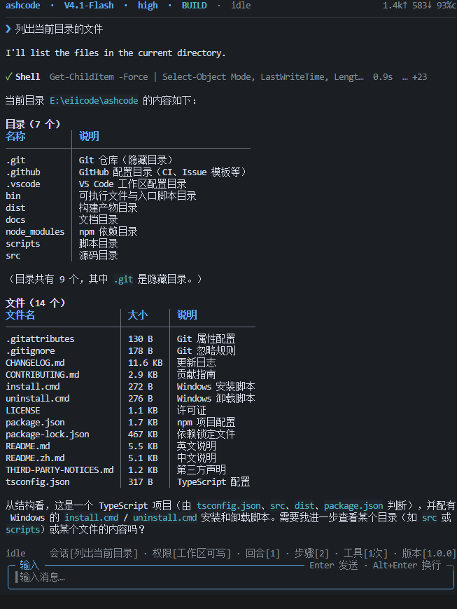

English | [中文](README.zh.md)

# ashcode

> If you already run DSH, what's missing is a good terminal surface. ashcode is that surface.

A terminal client for [DeepSeek Harness](https://github.com/deepseek-ai/deepseek-harness) (`dsh`): chat, tool cards, approvals, structured questions, plan/build mode, session resume, crash recovery, and usage/cost stats.

**Quick start** — Windows 10/11, Node.js ≥ 24.9, and your own DeepSeek API key:

```powershell
irm https://github.com/eiicode/ashcode/releases/latest/download/install.ps1 | iex
```

Then open a new terminal and run `ashcode`. Prefer to read it first? [View the installer](https://github.com/eiicode/ashcode/releases/latest/download/install.ps1) or [download the zip](https://github.com/eiicode/ashcode/releases/latest).



> **Unofficial client.** ashcode is an independent open-source project. It is not affiliated with, or endorsed by, DeepSeek. Model calls use your own API key and are subject to the DeepSeek API terms of service.

> **Not a DSH plugin.** ashcode is a separate-process client; `dsh plugin add` cannot install it. Use the installer below.

> **Platform:** Windows 10/11 is verified. macOS/Linux scripts exist but have not been smoke-tested.

> **Requirements:** Node.js ≥ 24.9.0 (the DSH runtime's native addons require it) and Bun ≥ 1.3.14 (TUI rendering; the installer installs Bun if missing).

> **No `npx`:** the entry script's shebang points at Bun, so `npx ashcode` will not work.

**Install & usage:** [docs/USER-GUIDE.md](docs/USER-GUIDE.md). Design notes: [docs/adr/](docs/adr/). Issue templates are Chinese only.

## Install

Fastest path — one line, downloads and installs the latest release:

```powershell
irm https://github.com/eiicode/ashcode/releases/latest/download/install.ps1 | iex
```

Or from a downloaded package:

```powershell
# after extracting the release package
.\install.cmd
ashcode
```

The first launch asks for an API key; change it later with `/key`.

> The key is written in plain text to `.env.local` in the install directory (readable by local users only; never shipped in the repo or the release package). For better hygiene, inject `DEEPSEEK_API_KEY` from the environment instead of writing a file.

## Commands

| Command | Effect |
|---|---|
| `/new` | start a new session |
| `/sessions` | list sessions: switch / rename / delete |
| `/model` `/effort` | switch model and reasoning effort |
| `/team` | toggle agent teams |
| `/attach <path>` | attach an image |
| `/key` | set the API key |
| `/plan` | plan mode |

## Architecture

**A Bun process renders the TUI (OpenTUI) → a Node process runs `dsh --profile sdk` (stdio JSON-RPC).**

The two-process split is not a preference: Bun cannot load DSH's native addons, and Node cannot render OpenTUI. The experiments are recorded in [ADR-0002](docs/adr/0002-m0-verdict-cross-process.md).

Decision records: [ADR-0001](docs/adr/0001-ashcode-architecture.md) · [0002](docs/adr/0002-m0-verdict-cross-process.md) · [0003](docs/adr/0003-m2-m3-delivery.md) · [0004](docs/adr/0004-known-issues-fixes.md) · [0005](docs/adr/0005-styling-install.md) · [0006](docs/adr/0006-packaging-install.md) · [0007](docs/adr/0007-ui-redesign.md) · [0008](docs/adr/0008-composer-and-noise.md) · [0009](docs/adr/0009-input-and-status.md) · [0010](docs/adr/0010-sessions-usage-key.md) · [0011](docs/adr/0011-mode-timer-model.md) · [0012](docs/adr/0012-default-model-effort.md) · [0013](docs/adr/0013-sidebar-stats-attach.md) · [0014](docs/adr/0014-team-mode.md) · [CHANGELOG](CHANGELOG.md)

## Run from source

```powershell
npm install          # many dependencies; first run takes a few minutes
npm run typecheck
npm run tui          # = bun src/ui/app.ts
```

> `npm run tui` bypasses `bin/ashcode.mjs`, so it does **not** read `.env.local`: set `DEEPSEEK_API_KEY` in the environment first.
> To run an installed copy instead, use `npm run install:local` and then `ashcode`.

## Development

| Command | Effect |
|---|---|
| `npm run typecheck` | `tsc --noEmit` |
| `npm run tui` | run the TUI directly (needs Bun) |
| `npm run install:local` | install into `%LOCALAPPDATA%\ashcode` |
| `npm test` | 19 ConPTY smokes (see below) |
| `npm run smoke:<name>` | a single smoke, e.g. `npm run smoke:tui` |

`npm test` needs Windows, an installed copy of ashcode, a real `DEEPSEEK_API_KEY`, and `bun.exe` at `%APPDATA%\npm\node_modules\bun\bin\bun.exe`. **It cannot run in CI** — CI only runs `typecheck` and `pack`. Details in [CONTRIBUTING.md](CONTRIBUTING.md) (Chinese).

## Environment variables

| Variable | Default | Effect |
|---|---|---|
| `DEEPSEEK_API_KEY` | — | model credential; may also live in `.env.local` |
| `ASHCODE_HOME` | see below | DSH data directory, same as `--home` |
| `ASHCODE_MODEL` | `deepseek-flash` | model id |
| `ASHCODE_EFFORT` | `high` | reasoning effort: `off` / `low` / `high` / `max` |
| `ASHCODE_THEME` | `dark` | `dark` / `light` / `contrast` / `ansi` |
| `ASHCODE_ENTER` | `send` | set to `newline` to make Enter insert a newline and Ctrl+Enter send |
| `ASHCODE_TEAM` | off | `1` enables agent teams by default |
| `ASHCODE_MOUSE` | on | `0` disables the mouse |
| `ASHCODE_DEBUG` | off | write `.tui-debug.log` |
| `ASHCODE_PERMISSION_MODE` | `workspace-write` | initial permission preset |
| `ASHCODE_PRICE_INPUT` / `_CACHE` / `_OUTPUT` | — | override prices (USD per million tokens) for cost estimates; `_CACHE` falls back to `_INPUT` |
| `ASHCODE_NODE_EXECUTABLE` | `node` | Node executable used to run DSH |

Data directory precedence: `--home` > `ASHCODE_HOME` > default (`./.dsh-home` when run from the source tree, `~/.ashcode` for an installed copy).

## Project layout

```
src/ui/app.ts             main render loop, state machine, panels, input handling
src/ui/render.ts          line / span model and layout helpers
src/ui/markdown.ts        terminal Markdown rendering
src/ui/theme.ts           semantic palette
src/runtime/stdio-sdk.ts  spawns `dsh --profile sdk` and speaks stdio JSON-RPC
bin/ashcode.mjs           entry: loads .env.local, --help / --version
scripts/                  install, pack, release, smokes
docs/adr/                 architecture decision records
```

## License

MIT, see [LICENSE](LICENSE). Third-party notices in [THIRD-PARTY-NOTICES.md](THIRD-PARTY-NOTICES.md).
