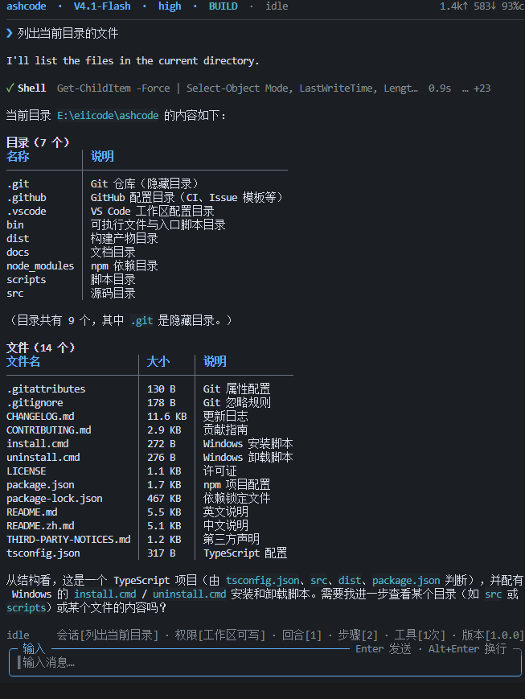

# ashcode

[English](README.md) | 中文

> 用 DSH 的人，缺一个好用的终端门面。ashcode 就是这个门面。

终端里的 DeepSeek Harness 客户端：对话、工具卡、审批、结构化提问、plan/build 模式、会话恢复、崩溃自恢复、用量统计。

**快速开始** —— 需要 Windows 10/11、Node.js ≥ 24.9，以及你自己的 DeepSeek API Key：

```powershell
irm https://github.com/eiicode/ashcode/releases/latest/download/install.ps1 | iex
```

装完新开一个终端，输入 `ashcode` 即可。想先看脚本？[查看安装器](https://github.com/eiicode/ashcode/releases/latest/download/install.ps1) 或 [下载 zip](https://github.com/eiicode/ashcode/releases/latest)。



> **非官方客户端**：ashcode 是独立开源项目，与 DeepSeek 无隶属关系，也未获其背书。模型调用使用你自己的 API Key，受 DeepSeek API 服务条款约束。

> **不是 DSH 插件**：ashcode 是独立进程客户端，`dsh plugin add` 无法安装它，请用下方安装器。

> **平台**：Windows 10/11 已验证；macOS/Linux 仅提供脚本，未做冒烟验证。

> **依赖**：Node.js ≥ 24.9.0（DSH 运行时，其原生插件要求）、Bun ≥ 1.3.14（TUI 渲染；安装器缺失时会自动安装）。

> **不支持 `npx`**：入口脚本的 shebang 指向 Bun，`npx ashcode` 无法运行。

**安装与使用**：[docs/USER-GUIDE.md](docs/USER-GUIDE.zh.md)（面向用户）；本文档面向开发者。

## 安装

最快的方式是一行命令，自动下载并安装最新版本：

```powershell
irm https://github.com/eiicode/ashcode/releases/latest/download/install.ps1 | iex
```

或者从下载好的发布包安装：

```powershell
# 解压发布包后
.\install.cmd
ashcode
```

首次启动会提示输入 API Key，之后可用 `/key` 更换。

> API Key 以明文保存在安装目录的 `.env.local`（仅本机用户可读，不随仓库或发布包分发）。如需更高安全性，请改用环境变量 `DEEPSEEK_API_KEY` 注入，不要写入文件。

## 常用命令

| 命令 | 作用 |
|---|---|
| `/new` | 新建会话 |
| `/sessions` | 会话列表：切换 / 重命名 / 删除 |
| `/model` `/effort` | 切换模型与推理等级 |
| `/team` | 智能体团队开关 |
| `/attach <path>` | 附加图片 |
| `/key` | 设置 API Key |
| `/plan` | plan 模式 |

## 架构

**Bun 进程渲染 TUI（OpenTUI）→ Node 进程跑 `dsh --profile sdk`（stdio JSON-RPC）**。

分成两个进程不是设计偏好：Bun 加载不了 DSH 的原生插件，Node 渲染不了 OpenTUI。实验记录见 ADR-0002。

决策记录：[ADR-0001](docs/adr/0001-ashcode-architecture.zh.md) · [0002](docs/adr/0002-m0-verdict-cross-process.zh.md) · [0003](docs/adr/0003-m2-m3-delivery.zh.md) · [0004](docs/adr/0004-known-issues-fixes.zh.md) · [0005](docs/adr/0005-styling-install.zh.md) · [0006](docs/adr/0006-packaging-install.zh.md) · [0007](docs/adr/0007-ui-redesign.zh.md) · [0008](docs/adr/0008-composer-and-noise.zh.md) · [0009](docs/adr/0009-input-and-status.zh.md) · [0010](docs/adr/0010-sessions-usage-key.zh.md) · [0011](docs/adr/0011-mode-timer-model.zh.md) · [0012](docs/adr/0012-default-model-effort.zh.md) · [0013](docs/adr/0013-sidebar-stats-attach.zh.md) · [0014](docs/adr/0014-team-mode.zh.md) · [CHANGELOG](CHANGELOG.zh.md)

## 从源码运行

```powershell
npm install          # 依赖较多，首次几分钟；peer 冲突时加 --legacy-peer-deps
npm run typecheck
npm run tui          # = bun src/ui/app.ts
```

> `npm run tui` 不经过 `bin/ashcode.mjs`，**不会**读取 `.env.local`：请先设置环境变量 `DEEPSEEK_API_KEY`。
> 想跑安装态用 `npm run install:local`，之后直接用 `ashcode`。

## 开发

| 命令 | 作用 |
|---|---|
| `npm run typecheck` | `tsc --noEmit` |
| `npm run tui` | 直接运行 TUI（需 Bun） |
| `npm run install:local` | 安装到 `%LOCALAPPDATA%\ashcode` |
| `npm test` | 19 个 ConPTY 冒烟（见下） |
| `npm run smoke:<name>` | 单个冒烟，如 `npm run smoke:tui` |

`npm test` 需要 Windows + 已安装的 ashcode + 真实 `DEEPSEEK_API_KEY`，并假定 `bun.exe` 在 `%APPDATA%\npm\node_modules\bun\bin\bun.exe`。**它无法在 CI 运行**，CI 只跑 `typecheck` 与 `pack`。细节见 [CONTRIBUTING.md](CONTRIBUTING.zh.md)。

## 环境变量

| 变量 | 默认 | 作用 |
|---|---|---|
| `DEEPSEEK_API_KEY` | — | 模型凭据；也可写入应用目录 `.env.local` |
| `ASHCODE_HOME` | 见下 | DSH 数据目录，等同 `--home` |
| `ASHCODE_MODEL` | `deepseek-flash` | 模型 id |
| `ASHCODE_EFFORT` | `high` | 推理等级 `off` / `low` / `high` / `max` |
| `ASHCODE_THEME` | `dark` | `dark` / `light` / `contrast` / `ansi` |
| `ASHCODE_ENTER` | `send` | 设为 `newline` 则 Enter 换行、Ctrl+Enter 发送 |
| `ASHCODE_TEAM` | 关 | `1` 默认开启智能体团队 |
| `ASHCODE_MOUSE` | 开 | `0` 关闭鼠标 |
| `ASHCODE_DEBUG` | 关 | 写 `.tui-debug.log` |
| `ASHCODE_PERMISSION_MODE` | `workspace-write` | 启动时的权限预设 |
| `ASHCODE_PRICE_INPUT` / `_CACHE` / `_OUTPUT` | — | 覆盖价格（美元 / 百万 token），用于费用估算；`_CACHE` 缺省时跟随 `_INPUT` |
| `ASHCODE_NODE_EXECUTABLE` | `node` | 指定运行 DSH 的 Node 可执行文件 |

数据目录优先级：`--home` > `ASHCODE_HOME` > 默认值（在源码目录里运行用 `./.dsh-home`，安装版用 `~/.ashcode`）。

## 项目结构

```
src/ui/app.ts          主渲染循环、状态机、面板、输入处理
src/ui/render.ts       行 / span 模型与布局辅助
src/ui/markdown.ts     终端 Markdown 渲染
src/ui/theme.ts        语义调色板
src/runtime/stdio-sdk.ts  拉起 `dsh --profile sdk` 并走 stdio JSON-RPC
bin/ashcode.mjs        入口：加载 .env.local、--help / --version
scripts/               安装、打包、发布、冒烟
docs/adr/              架构决策记录
```

## 许可证

MIT，见 [LICENSE](LICENSE)。第三方组件声明见 [THIRD-PARTY-NOTICES.md](THIRD-PARTY-NOTICES.md)。
